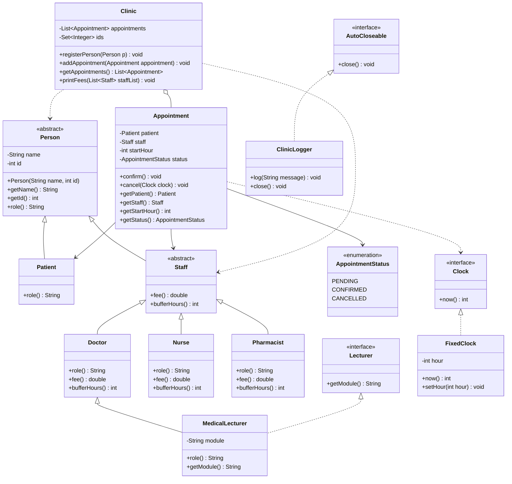

Clinic Appointment System
Name: IRVINE MANGUDHLA            Student Number: R2420384
Name: MAKANAKA MITCHELLE MASIIWA  Student Number: R2420425s

Project: Clinic Appointment System Mini Project
The Clinic Appointment System is a Java-based application that allows patients to book and manage appointments with clinic staff.

The system demonstrates core Object-Oriented Programming principles, including:

Abstraction
Encapsulation
Inheritance
Polymorphism
Interfaces
Dependency Injection
Exception Handling
Resource Management
The application manages patients, staff members and appointments while enforcing clinic business rules.

Class Structure
Person (Abstract)---> Patient │ Staff (Abstract) --->Doctor ---> Nurse----> Pharmacist

Lecturer (Interface)

Clinic

Appointment

Clock (Interface)

FixedClock

ClinicLogger

AppointmentStatus (Enum)

UML Class Diagram

OOP Concepts Demonstrated
1. Abstraction
The Person and Staff classes are abstract.

These classes define common behaviour shared by all people and staff members while preventing direct object creation.

Example:

public abstract class Person

2. Encapsulation

Fields are private and accessed through getters.

Example:

Java
private String name;
private int id;

Benefits:

Protects data
Prevents accidental modification
Maintains object integrity
3. Inheritance

Doctor, Nurse and Pharmacist inherit from Staff.

Patient inherits from Person.

Example:

Java
public class Doctor extends Staff
4. Polymorphism

Staff objects are treated uniformly.

Example:

Java
for(Staff s : staffList){
System.out.println(s.fee());
}

Different fee methods are executed automatically.

5. Interface

Lecturer is implemented by MedicalLecturer.

Example:

Java
public class MedicalLecturer
extends Doctor
implements Lecturer

This solves the multiple inheritance problem.

Appointment States

Appointments use the following states:

PENDING
CONFIRMED
CANCELLED

Legal transitions:

PENDING -> CONFIRMED

PENDING -> CANCELLED

CONFIRMED -> CANCELLED

Illegal transitions:

CANCELLED -> ANY STATE

Business Rules

The system enforces:

Rule 1

Patient IDs must be unique.

Rule 2

Staff IDs must be unique.

Rule 3

Appointments cannot be booked at invalid times.

Rule 4

Appointments cannot be cancelled after they have started.

Rule 5

Confirmed appointments cannot be cancelled less than 2 hours before the start time.

Rule 6

Buffer times between appointments are enforced.

Doctor = 2 hours

Nurse = 1 hour

Pharmacist = 0 hours

Dependency Injection

The system does not access the computer clock directly.

Instead, a Clock interface is used.

Example:

Java
public interface Clock {
int now();
}

Benefits:

Easier testing
Reduced coupling
More flexible design
Defensive Copying
